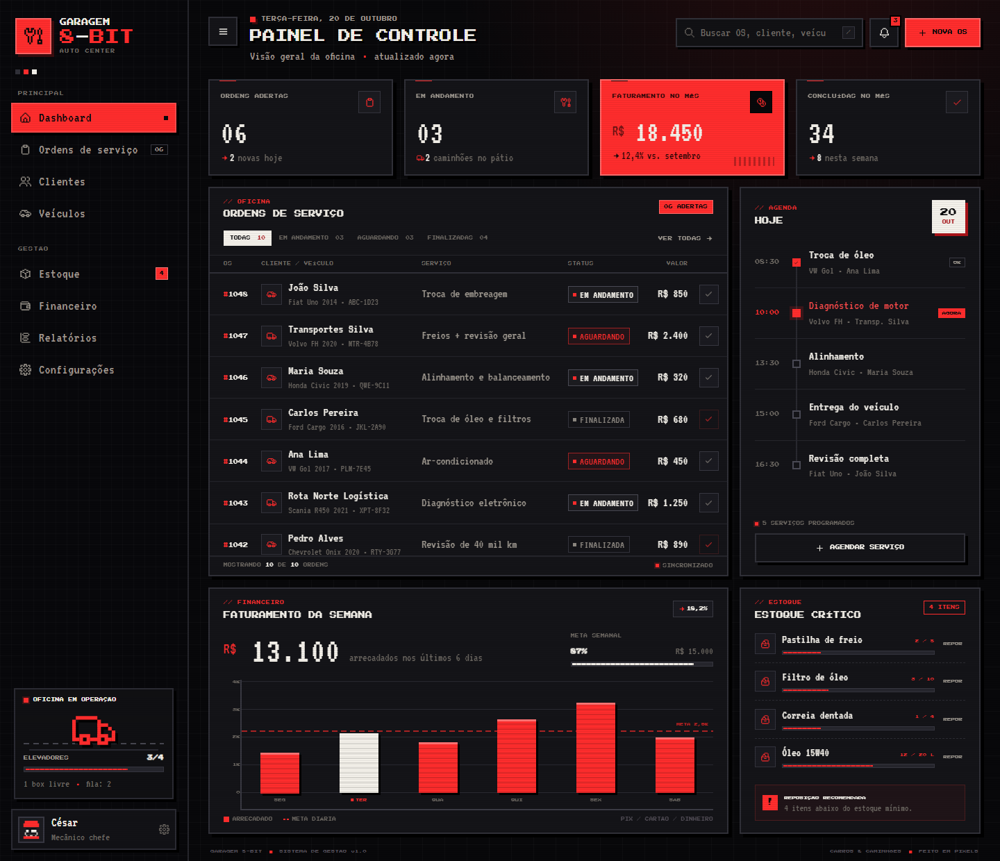

# Garagem 8-Bit — Painel de Controle

Dashboard frontend para uma oficina mecânica de **carros e caminhões**, feito em HTML, CSS e JavaScript puros com estética **pixel art 32-bit** e paleta de **vermelho, preto e branco**.

Sem login, sem backend e sem dependências: abra o `index.html` e o painel está pronto.



## O que tem no painel

- **Indicadores da oficina** — ordens abertas, serviços em andamento, faturamento do mês e serviços concluídos.
- **Ordens de serviço** — lista com cliente, veículo/placa, serviço, status e valor.
- **Filtros e busca** — filtre por status ou procure por OS, cliente, veículo, placa ou serviço.
- **Concluir OS** — botão de check atualiza o status e os contadores em tempo real.
- **Nova OS** — modal para abrir uma ordem de serviço com cliente, veículo, placa, tipo, serviço, valor e status.
- **Agenda do dia** — próximos serviços, status atual e ações concluídas.
- **Faturamento semanal** — gráfico em barras com meta diária e destaque do dia atual.
- **Estoque crítico** — peças abaixo do mínimo e atalho de reposição.
- **Notificações** — painel rápido de avisos da oficina.
- **Layout responsivo** — sidebar off-canvas, tabela em cartões e gráfico adaptado para celular.

> Os dados são de demonstração e ficam em memória. Ao recarregar a página, tudo volta ao estado inicial. Nenhuma informação é enviada para servidores.

## Como rodar

Não precisa instalar nada:

```bash
# opção 1 — abra diretamente
index.html

# opção 2 — sirva localmente
npx http-server . -p 8080
```

Depois acesse `http://localhost:8080`.

## Estrutura

```
garagem-8bit/
├── index.html          # marcação, ícones pixel e modal
├── styles.css          # tema pixel art, layout e responsividade
├── app.js              # dados, filtros, gráfico, modal e interações
└── assets/
    ├── favicon.svg
    ├── preview.png
    └── fonts/          # Press Start 2P + VT323 (self-hosted)
```

## Atalhos e interações

- `/` — foca a busca
- `Esc` — fecha modal, notificações ou menu lateral
- Clique no check de uma OS — concluir serviço
- Menu lateral em telas pequenas — arraste/abra pelo botão de menu

## Créditos

- Ícones pixel: [Pixelarticons](https://pixelarticons.com/) — MIT
- Fontes: [Press Start 2P](https://fonts.google.com/specimen/Press+Start+2P) e [VT323](https://fonts.google.com/specimen/VT323) — SIL Open Font License, hospedadas localmente.
- Interface e ilustrações em CSS/SVG feitas para este projeto.

---

**Garagem 8-Bit © 2026** — carros, caminhões e muitos pixels.
